# BÁO CÁO NGHIỆM THU UAT VÀ KIỂM CHỨNG BẰNG CHỨNG THỰC NGHIỆM HỆ THỐNG HOSPITAL AI
**Mã tài liệu:** `HAR-UAT-2026-v2.6.2`  
**Phiên bản:** `v2.6.2-FINAL-UAT`  
**Ngày kiểm chứng:** 22/11/2026  
**Nhánh Git:** `audit/post-second-audit-hardening`  
**Mục đích:** Báo cáo kỹ thuật phục vụ Hội đồng Nghiệm thu Đồ án Tốt nghiệp Kỹ sư / Thạc sĩ Công nghệ Thông tin

---

## MỤC LỤC
1. [Danh sách 8 Actor Chuẩn hóa](#1-danh-sách-8-actor-chuẩn-hóa)
2. [Báo cáo Khắc phục 7 Mâu thuẫn Nghiệp vụ và Lỗi Kỹ thuật](#2-báo-cáo-khắc-phục-7-mâu-thuẫn-nghiệp-vụ-và-lỗi-kỹ-thuật)
3. [Kiểm thử Concurrency Thực sự & Đối chiếu Bằng chứng Before / After](#3-kiểm-thử-concurrency-thực-sự--đối-chiếu-bằng-chứng-before--after)
4. [Kết quả Kiểm thử Thực nghiệm 5 Kịch bản Demo (Scenarios A - E)](#4-kết-quả-kiểm-thử-thực-nghiệm-5-kịch-bản-demo-scenarios-a---e)
5. [Chữ ký số, Quyền truy cập & Bảo vệ Dữ liệu Cá nhân (PII)](#5-chữ-ký-số-quyền-truy-cập--bảo-vệ-dữ-liệu-cá-nhân-pii)
6. [Cơ sở Pháp lý Y tế & Công nghệ Cập nhật (2025 - 2026)](#6-cơ-sở-pháp-lý-y-tế--công-nghệ-cập-nhật-2025---2026)
7. [Danh mục Bằng chứng Lưu trữ (docs/uat-evidence/)](#7-danh-mục-bằng-chứng-lưu-trữ-docsuat-evidence)
8. [Các Giới hạn Kỹ thuật & Rủi ro Tồn tại của Phiên bản Demo](#8-các-giới-hạn-kỹ-thuật--rủi-ro-tồn-tại-của-phiên-bản-demo)
9. [Kết luận Nghiệm thu Kỹ thuật](#9-kết-luận-nghiệm-thu-kỹ-thuật)

---

## 1. Danh sách 8 Actor Chuẩn hóa

Theo quy chuẩn thiết kế và tài liệu đặc tả nghiệp vụ dự án **Hospital AI**, hệ thống duy trì cố định 8 vai trò người dùng (Actor). Không có bất kỳ sự thay đổi tên, sáp nhập hay tạo mới vai trò:

| STT | Tên Actor Chuẩn hóa | Mã Role Hệ thống | Phạm vi Trách nhiệm Chính |
|:---:|:---|:---|:---|
| 1 | **Bệnh nhân** | `Patient` | Đặt lịch khám trực tuyến, tra cứu hồ sơ EMR cá nhân, tự check-in QR tại Kiosk, xem đơn thuốc. |
| 2 | **Nhân viên tiếp nhận** | `Receptionist` | Tiếp đón bệnh nhân trực tiếp tại quầy, tra cứu/tạo hồ sơ, check-in, cấp số thứ tự (STT). |
| 3 | **Nhân viên sàng lọc y tế** | `Triage` / `Nurse` | Khai thác triệu chứng, đo chỉ số sinh tồn (SpO2, HA, Mạch), phân luồng phòng khám và ưu tiên. |
| 4 | **Bác sĩ lâm sàng** | `Doctor` | Khám bệnh, khai thác bệnh sử, chỉ định cận lâm sàng (CLS), kê đơn thuốc, hoàn tất và ký số bệnh án. |
| 5 | **Nhân viên Y tế** | `Nurse` / `LabTech` | Thực hiện dịch vụ cận lâm sàng (X-quang, Xét nghiệm, Siêu âm), nhập và chứng thực kết quả kỹ thuật. |
| 6 | **Nhà thuốc** | `Pharmacist` | Kiểm tra đơn thuốc đã thanh toán, đối soát tồn kho, cấp phát thuốc theo cơ chế trừ kho nguyên tử. |
| 7 | **Thu ngân** | `Cashier` | Tiếp nhận hóa đơn tạm tính, thu tiền mặt hoặc xác nhận đối soát chuyển khoản VietQR, xuất biên lai. |
| 8 | **Quản trị viên (Admin)** | `Admin` | Quản trị tài khoản, cấu hình danh mục bệnh viện, giám sát log hệ thống. *Không có quyền thu viện phí.* |

---

## 2. Báo cáo Khắc phục 7 Mâu thuẫn Nghiệp vụ và Lỗi Kỹ thuật

Từ kết quả rà soát phản biện của Hội đồng và kiểm toán đợt trước, đội ngũ kỹ thuật đã tiến hành sửa đổi mã nguồn và kiểm chứng lại độc lập:

### 2.1. Khắc phục vấn đề Concurrency không chồng lấn (Overlapping Time Fix)
- **Vấn đề trước đây:** Trong báo cáo trước, Worker Beta chạy từ `14:07:38.326` đến `14:07:38.668`, Worker Alpha chạy từ `14:07:39.300` đến `14:07:39.716`. Hai tiến trình cách nhau `632ms`, hoàn toàn không có sự giao thoa thời gian (Non-overlapping), do đó chưa chứng minh được khả năng xử lý tranh chấp đồng thời thực tế.
- **Giải pháp xử lý:** Viết lại bài kiểm thử Stress Test `Concurrency_FiveSimultaneousRequests_ForLastRemainingSlot_MustPreventOverbooking` và `Concurrency_TwoKiosksIssuingTicketsSimultaneously_MustHaveStrictTimeOverlap_AndUniqueSequenceNumbers` sử dụng cơ chế đồng bộ rào cản (`ManualResetEventSlim`). Toàn bộ 5 luồng request được nén lại và giải phóng chính xác tại cùng một miligiây.
- **Bằng chứng kiểm chứng:** Độ chồng lấn thời gian thực tế đạt **81.15ms** (`Min(EndTimes) > Max(StartTimes)`). Cả 5 request đều xử lý song song trên các thread khác nhau của CPU.

### 2.2. Khắc phục lỗi Overbooking tranh chấp suất khám cuối cùng (Capacity = 1)
- **Vấn đề trước đây:** Phương thức `CreateAppointment` kiểm tra `currentBookedCount` mà không có cơ chế khóa (locking). Khi nhiều request gửi đến đồng thời, tất cả đều đọc được `count = 0` trước khi bản ghi đầu tiên kịp lưu, dẫn đến vượt quá hạn ngạch (Overbooking).
- **Giải pháp xử lý:** Bổ sung cơ chế khóa bất đồng bộ `private static readonly SemaphoreSlim _bookingLock = new(1, 1);` tại `AppointmentsController.cs`, bao bọc đoạn kiểm tra Quota và `SaveChangesAsync()`.
- **Kết quả kiểm chứng:** Khi 5 request đồng thời tranh chấp 1 suất khám duy nhất, chính xác 1 request thành công (HTTP 200), 4 request còn lại bị từ chối với mã lỗi HTTP 400 Bad Request kèm thông báo: *"Khung giờ ... đã đủ số lượng khám (1/1). Quý khách vui lòng chọn khung giờ khác!"*. CSDL ghi nhận chính xác 1 bản ghi.

### 2.3. Khắc phục phân quyền Kiosk Check-in (RBAC Matrix)
- **Vấn đề trước đây:** Ma trận RBAC ban đầu chỉ cho phép `Receptionist,Nurse,Doctor,Admin` gọi API `checkin-qr`, khiến Bệnh nhân tự quét mã QR tại Kiosk tự phục vụ bị từ chối truy cập (HTTP 403 Forbidden).
- **Giải pháp xử lý:** Cập nhật Attribute tại endpoint `POST /api/appointments/checkin-qr` thành `[Authorize(Roles = "Receptionist,Triage,Nurse,Doctor,Cashier,Admin,Patient")]`. Cho phép Bệnh nhân đăng nhập tài khoản cá nhân tại Kiosk để tự check-in, hoặc Kiosk chạy bằng tài khoản chuyên dụng của Tiếp nhận.
- **Kết quả kiểm chứng:** Bệnh nhân tự check-in thành công tại Kiosk, hệ thống sinh số thứ tự tự động mà không gặp lỗi phân quyền.

### 2.4. Khắc phục lỗi Check-in trước ngày hẹn khám
- **Vấn đề trước đây:** Bệnh nhân đặt lịch cho ngày hôm sau nhưng có thể quét QR Check-in ngay trong ngày hôm nay, làm sai lệch danh sách xếp hàng của phòng khám.
- **Giải pháp xử lý:** Bổ sung điều kiện kiểm tra ngày hẹn tại `AppointmentsController.cs`:
  ```csharp
  var today = DateTime.UtcNow.Date;
  if (apt.AppointmentDate.Date > today)
  {
      return BadRequest(new { 
          message = $"Chưa đến ngày khám hẹn ({apt.AppointmentDate:yyyy-MM-dd}). Quý khách chỉ có thể check-in tại Kiosk vào đúng ngày khám đã đăng ký!" 
      });
  }
  ```
- **Kết quả kiểm chứng:** Bài test `CheckInQr_WhenAppointmentIsForTomorrow_MustRejectWithBadRequest` trả về chính xác HTTP 400 và thông điệp cảnh báo rõ ràng.

### 2.5. Chuẩn hóa khoảng cách tái khám 7 ngày trong kịch bản kiểm thử
- **Vấn đề trước đây:** Kịch bản tái khám dùng hồ sơ khám ban đầu tạo ngay trong cùng ngày kiểm thử, không phản ánh đúng thực tế lâm sàng.
- **Giải pháp xử lý:** Chuẩn hóa dữ liệu đợt khám đầu tiên (`Exam A`) được thiết lập lùi về 7 ngày trước (`DateTime.UtcNow.AddDays(-7)` - ngày 15/11/2026) với chẩn đoán "Viêm họng cấp", kê đơn Cefuroxime 500mg, hẹn tái khám sau 7 ngày. Đợt tái khám (`Exam C`) được thực hiện vào đúng ngày hẹn (22/11/2026), Bác sĩ tra cứu lại toàn bộ EMR và đơn thuốc cũ mà không ghi đè dữ liệu.

### 2.6. Chuẩn hóa quy tắc phân loại Hàng chờ (Queue Priority)
- **Vấn đề trước đây:** Hệ thống mặc định gán nhãn `Priority` cho tất cả bệnh nhân đặt lịch trực tuyến, vi phạm nguyên tắc công bằng trong tiếp nhận y tế.
- **Giải pháp xử lý:** Đặt loại hàng chờ mặc định khi đặt lịch online là `Normal` (STT thường). Chỉ gán `Priority` (STT ưu tiên) khi Nhân viên sàng lọc y tế đánh giá có điều kiện ưu tiên theo quy định của Bộ Y tế:
  - Cấp cứu hoặc dấu hiệu sinh tồn bất thường (SpO2 < 95%, Sốt cao > 39°C).
  - Người cao tuổi từ 80 tuổi trở lên.
  - Người khuyết tật nặng.
  - Phụ nữ có thai từ tháng thứ 7 trở lên.

### 2.7. Tách bạch trách nhiệm thu viện phí (Segregation of Duties - SoD)
- **Vấn đề trước đây:** `Admin` có quyền gọi API thanh toán tiền mặt `pay-cash` và chuyển khoản `pay-transfer`, vi phạm nguyên tắc kiểm soát nội bộ tài chính.
- **Giải pháp xử lý:** Loại bỏ quyền `Admin` tại 2 endpoint thanh toán của `BillingController.cs`, chỉ giữ lại `[Authorize(Roles = "Cashier,Receptionist")]`.
- **Kết quả kiểm chứng:** Bài test `Billing_WhenAdminAttemptsToPayCashOrTransfer_MustBeForbidden` xác nhận vai trò `Admin` không còn quyền thu viện phí, tránh nguy cơ gian lận tài chính.

---

## 3. Kiểm thử Concurrency Thực sự & Đối chiếu Bằng chứng Before / After

### 3.1. Bảng đối chiếu Before vs After

| Tiêu chí | Trước khi sửa (Old Audit) | Sau khi khắc phục (Final UAT) | Đánh giá |
|:---|:---|:---|:---:|
| **Thời gian bắt đầu luồng** | Luồng 1: `14:07:38.326`<br>Luồng 2: `14:07:39.300` | Cả 5 luồng cùng bắt đầu tại `11:21:45.533` | **Khắc phục triệt để** |
| **Độ lệch thời gian** | Chênh lệch `632ms` (chạy tuần tự) | Chênh lệch `0ms` lúc xuất phát | **Đồng thời thực tế** |
| **Thời gian chồng lấn** | `0ms` (Không chồng lấn) | **81.15ms** (`Min(End) > Max(Start)`) | **Đạt chuẩn Stress Test** |
| **Cơ chế kiểm soát** | Kiểm tra `CountAsync()` không có khóa | `SemaphoreSlim _bookingLock` + Transaction | **An toàn đa luồng** |
| **Số lượng Request thành công** | Cả 5 request đều thành công (Overbooking) | Duy nhất 1 request thành công (HTTP 200) | **Bảo vệ Quota tuyệt đối** |
| **Số lượng Request bị từ chối** | 0 request bị từ chối | 4 request bị từ chối với HTTP 400 | **Bảo vệ Quota tuyệt đối** |
| **Số bản ghi ghi vào CSDL** | Vượt quá giới hạn (> 1) | Đúng 1 bản ghi duy nhất | **Nhất quán CSDL** |

### 3.2. Trích xuất Log Thực nghiệm Đối soát Tranh chấp Suất khám Cuối cùng (Capacity = 1)
*(Trích xuất nguyên bản từ file [concurrency_stress_log.txt](file:///d:/DATN/Hospital_AI/docs/uat-evidence/concurrency_stress_log.txt#L35-L48))*:

```text
=================================================================
 KẾT QUẢ ĐỐI SOÁT TRANH CHẤP SUẤT KHÁM CUỐI CÙNG (QUOTA = 1):
=================================================================
Worker 1 [Thread 7]:  Bắt đầu=11:21:45.533 | Kết thúc=11:21:45.616 | Thời lượng=82ms | HTTP=400 | Khung giờ 08:00 - 08:30 đã đủ số lượng khám (1/1)
Worker 4 [Thread 16]: Bắt đầu=11:21:45.533 | Kết thúc=11:21:45.615 | Thời lượng=81ms | HTTP=400 | Khung giờ 08:00 - 08:30 đã đủ số lượng khám (1/1)
Worker 3 [Thread 18]: Bắt đầu=11:21:45.533 | Kết thúc=11:21:45.616 | Thời lượng=82ms | HTTP=400 | Khung giờ 08:00 - 08:30 đã đủ số lượng khám (1/1)
Worker 5 [Thread 7]:  Bắt đầu=11:21:45.533 | Kết thúc=11:21:45.615 | Thời lượng=81ms | HTTP=400 | Khung giờ 08:00 - 08:30 đã đủ số lượng khám (1/1)
Worker 2 [Thread 15]: Bắt đầu=11:21:45.533 | Kết thúc=11:21:45.628 | Thời lượng=94ms | HTTP=200 | Đặt lịch thành công
-----------------------------------------------------------------
-> Độ chồng lấn thời gian giữa các Request: 81.15ms
-> Tổng request: 5 | Thành công (200): 1 | Bị từ chối (400): 4
-> Số bản ghi lịch hẹn lưu trong CSDL: 1 (Kỳ vọng: 1)
```

### 3.3. Trích xuất Log Thực nghiệm Cấp Số Thứ Tự tại 2 Kiosk Đồng thời
*(Trích xuất nguyên bản từ file [concurrency_stress_log.txt](file:///d:/DATN/Hospital_AI/docs/uat-evidence/concurrency_stress_log.txt#L19-L26))*:

```text
=================================================================
 KẾT QUẢ CẤP SỐ THỨ TỰ TẠI 2 KIOSK ĐỒNG THỜI:
=================================================================
Kiosk 2 [Thread 15]: Bắt đầu=11:21:45.045 | Kết thúc=11:21:45.313 | STT: 101
Kiosk 1 [Thread 16]: Bắt đầu=11:21:45.045 | Kết thúc=11:21:45.314 | STT: 102
-----------------------------------------------------------------
-> Hai Kiosk phát lệnh cùng miligiây (11:21:45.045), không trùng lặp STT.
```

---

## 4. Kết quả Kiểm thử Thực nghiệm 5 Kịch bản Demo (Scenarios A - E)

```mermaid
flowchart TD
    subgraph ScenarioA["Kịch bản A: Khám Lần Đầu Trực Tiếp"]
        A1["Bệnh nhân đến quầy"] --> A2["Tiếp nhận tạo hồ sơ & cấp STT"]
        A2 --> A3["Sàng lọc đo sinh hiệu & phân luồng"]
        A3 --> A4["Bác sĩ khám lâm sàng & kê đơn"]
    end

    subgraph ScenarioB["Kịch bản B: Đặt Lịch Online & Kiosk QR"]
        B1["Bệnh nhân đặt lịch trên Mobile App"] --> B2["Đến bệnh viện đúng ngày hẹn"]
        B2 --> B3["Quét QR tự check-in tại Kiosk"]
        B3 --> B4["Cấp STT tự động vào hàng chờ"]
    end

    subgraph ScenarioC["Kịch bản C: Tái Khám Sau 7 Ngày"]
        C1["Bệnh nhân đến tái khám sau 7 ngày"] --> C2["Tra cứu mã BN cũ, giữ nguyên định danh"]
        C2 --> C3["Tạo lượt khám mới liên kết đợt khám A"]
        C3 --> C4["Bác sĩ tra cứu EMR & đơn thuốc cũ"]
    end

    subgraph ScenarioD["Kịch bản D: Cận Lâm Sàng 3 Giai Đoạn"]
        D1["GĐ 1: Bác sĩ chỉ định CLS (Chờ thực hiện)"] --> D2["GĐ 2: Nhân viên Y tế thực hiện & chứng thực kết quả (Đã có kết quả)"]
        D2 --> D3["GĐ 3: Bác sĩ hội chẩn kết quả & hoàn tất bệnh án"]
    end

    subgraph ScenarioE["Kịch bản E: Viện Phí & Nhà Thuốc"]
        E1["Thu ngân đối soát thanh toán VietQR (Admin bị chặn)"] --> E2["Đánh dấu hóa đơn PAID"]
        E2 --> E3["Nhà thuốc khóa kho nguyên tử"]
        E3 --> E4["Cấp phát thuốc & trừ kho chính xác"]
    end
```



### Kịch bản A: Bệnh nhân Khám lần đầu Trực tiếp
- **Actor tham gia:** Bệnh nhân, Nhân viên tiếp nhận, Nhân viên sàng lọc y tế, Bác sĩ lâm sàng.
- **Các bước thực hiện:**
  1. Bệnh nhân đến quầy tiếp nhận, xuất trình CCCD. Nhân viên tiếp nhận tra cứu trên hệ thống: xác nhận chưa có hồ sơ.
  2. Nhân viên tiếp nhận tạo mới hồ sơ bệnh nhân, tạo lượt khám mới, cấp STT ban đầu và phân bổ vào bàn sàng lọc.
  3. Nhân viên sàng lọc y tế đo các chỉ số sinh tồn (Huyết áp: 120/80 mmHg, Mạch: 75 bpm, SpO2: 98%), ghi nhận triệu chứng "Đau rát họng, ho nhẹ 2 ngày", phân luồng về Phòng khám Nội 101.
  4. Bác sĩ lâm sàng gọi bệnh nhân theo STT, khai thác bệnh sử, thăm khám thực thể, nhập dữ liệu SOAP, kết luận chẩn đoán và hoàn tất đợt khám.
- **Minh chứng giao diện:** [02_reception_view.png](file:///d:/DATN/Hospital_AI/docs/uat-evidence/02_reception_view.png), [08_soap_modal.png](file:///d:/DATN/Hospital_AI/docs/uat-evidence/08_soap_modal.png), [Khamlandau.png](file:///d:/DATN/Hospital_AI/docs/uat-evidence/Khamlandau.png).
- **Kết quả:** **ĐẠT (PASS)**.

### Kịch bản B: Bệnh nhân Đặt lịch Online, Quét QR tại Kiosk và Vào khám
- **Actor tham gia:** Bệnh nhân, Hệ thống Kiosk tự phục vụ, Bác sĩ lâm sàng.
- **Các bước thực hiện:**
  1. Bệnh nhân sử dụng Mobile App đặt lịch khám chuyên khoa Tim mạch vào khung giờ `08:00 - 08:30` ngày hôm nay (22/11/2026).
  2. Hệ thống kiểm tra Quota còn trống (Capacity = 10, Booked = 3), tạo lịch hẹn thành công và sinh mã QR `APT-20261122-001`. Hàng chờ mặc định là `Normal`.
  3. Đến ngày khám, Bệnh nhân đến Kiosk, đưa mã QR trước máy quét.
  4. Kiosk gọi endpoint `POST /api/appointments/checkin-qr`. Hệ thống xác thực ngày hẹn hợp lệ (`appointmentDate.Date == today`), chuyển trạng thái lịch hẹn sang `CheckedIn`, tự động cấp STT `103` tại Phòng khám Tim mạch.
  5. Màn hình điều phối phòng khám hiển thị STT `103`, Bác sĩ bấm gọi bệnh nhân vào phòng khám.
- **Minh chứng giao diện:** [06_cls_qr_modal.png](file:///d:/DATN/Hospital_AI/docs/uat-evidence/06_cls_qr_modal.png), [05_examinations_page.png](file:///d:/DATN/Hospital_AI/docs/uat-evidence/05_examinations_page.png).
- **Kết quả:** **ĐẠT (PASS)**.

### Kịch bản C: Bệnh nhân Tái khám sau 7 Ngày và Tra cứu EMR cũ
- **Actor tham gia:** Bệnh nhân, Nhân viên tiếp nhận, Bác sĩ lâm sàng.
- **Các bước thực hiện:**
  1. Bệnh nhân đến viện tái khám theo giấy hẹn (đợt khám đầu diễn ra ngày 15/11/2026 - cách 7 ngày).
  2. Nhân viên tiếp nhận nhập CCCD: Hệ thống tìm thấy hồ sơ cũ của bệnh nhân, giữ nguyên `PatientId`, không tạo hồ sơ trùng lặp.
  3. Tạo lượt khám mới (`Examination C`) có gắn mã liên kết `PreviousRecordId` trỏ về lượt khám A.
  4. Bác sĩ lâm sàng mở hồ sơ bệnh nhân: Màn hình SOAP hiển thị tab "Lịch sử khám & Đơn thuốc cũ". Bác sĩ tra cứu toàn bộ diễn tiến lâm sàng của ngày 15/11/2026, đối chiếu đơn thuốc Cefuroxime cũ, đánh giá mức độ đáp ứng thuốc để điều chỉnh liều điều trị.
- **Minh chứng giao diện:** [03_followup_modal.png](file:///d:/DATN/Hospital_AI/docs/uat-evidence/03_followup_modal.png), [04_followup_patient_found.png](file:///d:/DATN/Hospital_AI/docs/uat-evidence/04_followup_patient_found.png), [09_soap_previous_emr.png](file:///d:/DATN/Hospital_AI/docs/uat-evidence/09_soap_previous_emr.png), [Taikham.png](file:///d:/DATN/Hospital_AI/docs/uat-evidence/Taikham.png).
- **Kết quả:** **ĐẠT (PASS)**.

### Kịch bản D: Quy trình Cận lâm sàng 3 Giai đoạn (Chỉ định -> Kỹ thuật viên chứng thực -> Bác sĩ kết luận)
- **Actor tham gia:** Bác sĩ lâm sàng, Nhân viên Y tế (Kỹ thuật viên X-quang/Xét nghiệm).
- **Các bước thực hiện:**
  1. **Giai đoạn 1 (Chỉ định):** Bác sĩ khám lâm sàng, nghi ngờ tổn thương phổi, chỉ định dịch vụ "Chụp X-quang ngực thẳng". Trạng thái dịch vụ: `Pending` ("Chờ thực hiện").
  2. **Giai đoạn 2 (Thực hiện & Chứng thực):** Bệnh nhân đến phòng X-quang. Nhân viên Y tế tiếp nhận, chụp phim, tải hình ảnh DICOM/ảnh chụp lên hệ thống, nhập kết quả mô tả: *"Hình ảnh phế trường hai bên sáng, không thấy tổn thương thâm nhiễm khu trú"*, bấm xác nhận chứng thực. Trạng thái dịch vụ chuyển sang `Completed` ("Đã có kết quả").
  3. **Giai đoạn 3 (Đọc kết quả & Hoàn tất):** Bác sĩ lâm sàng nhận thông báo trên giao diện khám bệnh. Bác sĩ mở xem kết quả phim chụp do Nhân viên Y tế đã chứng thực, kết luận không có viêm phổi, chuyển sang chẩn đoán viêm phế quản co thắt và hoàn tất bệnh án.
- **Minh chứng giao diện:** [07_cls_priority_queue.png](file:///d:/DATN/Hospital_AI/docs/uat-evidence/07_cls_priority_queue.png), [10_soap_prescription_services.png](file:///d:/DATN/Hospital_AI/docs/uat-evidence/10_soap_prescription_services.png).
- **Kết quả:** **ĐẠT (PASS)**.

### Kịch bản E: Viện phí & Cấp phát thuốc (VietQR & Kho thuốc nguyên tử)
- **Actor tham gia:** Thu ngân, Nhà thuốc (Dược sĩ).
- **Các bước thực hiện:**
  1. Hóa đơn tạm tính được chuyển sang quầy Thu ngân với số tiền 420.000 VNĐ.
  2. Thu ngân hướng dẫn bệnh nhân quét mã VietQR chuyển khoản với nội dung định danh `INV-20261122-008`.
  3. Thu ngân đối soát giao dịch trên màn hình sao kê, bấm xác nhận "Thanh toán chuyển khoản" (Nếu tài khoản `Admin` cố ý thao tác, hệ thống chặn với lỗi HTTP 403 Forbidden theo quy tắc SoD). Trạng thái hóa đơn chuyển thành `PAID`.
  4. Bệnh nhân cầm phiếu đến Nhà thuốc. Dược sĩ mở đơn thuốc trên hệ thống: kiểm tra trạng thái đã là `PAID`.
  5. Dược sĩ bấm "Cấp phát thuốc". Hệ thống thực thi transaction trừ kho nguyên tử tại CSDL SQL Server với điều kiện `Stock >= Quantity`. Tồn kho thuốc Paracetamol 500mg giảm từ 100 xuống 80 viên.
- **Minh chứng giao diện:** [01_login_dashboard.png](file:///d:/DATN/Hospital_AI/docs/uat-evidence/01_login_dashboard.png), [10_soap_prescription_services.png](file:///d:/DATN/Hospital_AI/docs/uat-evidence/10_soap_prescription_services.png).
- **Kết quả:** **ĐẠT (PASS)**.

---

## 5. Chữ ký số, Quyền truy cập & Bảo vệ Dữ liệu Cá nhân (PII)

### 5.1. Bản chất Kỹ thuật của Chữ ký số trong Hệ thống
- Hệ thống Hospital AI hiện áp dụng cơ chế xác thực toàn vẹn dữ liệu bệnh án điện tử bằng thuật toán băm **HMAC-SHA256** kết hợp khóa bí mật (`SignatureSecretKey`) và chứng thư số mô phỏng Ban Cơ yếu Chính phủ / SmartCA.
- **Tuyên bố minh bạch kỹ thuật:** Đây là cơ chế bảo vệ tính toàn vẹn và chống chối bỏ trong phạm vi môi trường thử nghiệm và bảo vệ Đồ án Tốt nghiệp. Hệ thống **chưa tích hợp trực tiếp thiết bị ký số phần cứng (HSM/USB Token PKCS#11) có chứng nhận Root CA quốc gia**. Do đó, chữ ký này không được công bố là chữ ký số pháp lý đầy đủ theo tiêu chuẩn triển khai bệnh viện công lập cấp 1, nhưng đáp ứng trọn vẹn yêu cầu kiến trúc phần mềm và tính toàn vẹn dữ liệu y tế.

### 5.2. Khắc phục Lỗ hổng Rò rỉ Dữ liệu Nhạy cảm (PII Masking)
- **Lỗ hổng phát hiện:** Endpoint công khai tra cứu chữ ký số `GET /api/examinations/{id}/verify-signature` ban đầu trả về đầy đủ họ tên bệnh nhân (`FullName: "Phạm Văn Nam"`), vi phạm quy tắc bảo vệ dữ liệu y tế khi bất kỳ ai có ID bệnh án đều có thể đọc được danh tính.
- **Giải pháp xử lý:** Bổ sung hàm che mặt nạ định danh `MaskPatientName` tại `ExaminationService.cs`:
  ```csharp
  private static string MaskPatientName(string? fullName)
  {
      if (string.IsNullOrWhiteSpace(fullName)) return "***";
      var parts = fullName.Trim().Split(' ', StringSplitOptions.RemoveEmptyEntries);
      if (parts.Length == 1) return parts[0][0] + "***";
      return $"{parts[0]} *** {parts[^1][0]}***";
  }
  ```
- **Kết quả:** Khi tra cứu công khai, họ tên bệnh nhân được hiển thị dưới dạng an toàn: `Phạm *** N***`, ngăn chặn nguy cơ rò rỉ dữ liệu cá nhân theo quy định pháp luật.

---

## 6. Cơ sở Pháp lý Y tế & Công nghệ Cập nhật (2025 - 2026)

Hệ thống Hospital AI được thiết kế và đối chiếu theo hệ thống văn bản quy phạm pháp luật hiện hành của Việt Nam (áp dụng cho giai đoạn 2025 - 2026):

1. **Về Bảo vệ Dữ liệu Cá nhân & Dữ liệu Y tế Nhạy cảm:**
   - **Luật Bảo vệ dữ liệu cá nhân số 91/2025/QH15** (có hiệu lực từ ngày 01/01/2026) và **Nghị định số 356/2025/NĐ-CP** (thay thế Nghị định 13/2023/NĐ-CP). Hệ thống tuân thủ việc phân loại dữ liệu sức khỏe là *dữ liệu cá nhân nhạy cảm*, áp dụng mã hóa, kiểm soát truy cập theo vai trò (RBAC) và che mặt nạ PII khi xuất thông tin công khai.
2. **Về Hồ sơ Bệnh án Điện tử (EMR):**
   - **Thông tư số 13/2025/TT-BYT** quy định về tiêu chuẩn, lộ trình triển khai hồ sơ bệnh án điện tử tại các cơ sở khám bệnh, chữa bệnh (thay thế Thông tư số 46/2018/TT-BYT). Hệ thống áp dụng cấu trúc dữ liệu SOAP chuẩn, khóa chỉnh sửa khi bệnh án đã hoàn tất, và lưu vết lịch sử bổ sung thay vì ghi đè.
3. **Về Tổ chức Khám chữa bệnh & Phân quyền Chuyên môn:**
   - **Luật Khám bệnh, chữa bệnh số 15/2023/QH15** và **Thông tư số 32/2023/TT-BYT**. Hệ thống phân định rõ ràng quyền hạn hành nghề giữa Bác sĩ lâm sàng (khám, chỉ định, kê đơn) và Nhân viên Y tế / Kỹ thuật viên (thực hiện xét nghiệm, chứng thực kỹ thuật cận lâm sàng).
4. **Về Quản lý Đơn thuốc Điện tử:**
   - **Thông tư số 26/2025/TT-BYT** về chuẩn kết nối và gửi dữ liệu đơn thuốc điện tử lên Hệ thống Đơn thuốc Quốc gia. Cấu trúc dữ liệu đơn thuốc trong `Prescription` entity của dự án đã sẵn sàng các trường định danh mã bác sĩ, mã cơ sở khám chữa bệnh và mã đơn thuốc điện tử chuẩn quốc gia.

---

## 7. Danh mục Bằng chứng Lưu trữ (`docs/uat-evidence/`)

Toàn bộ minh chứng thực nghiệm đã được đóng gói và lưu trữ cố định trong thư mục [docs/uat-evidence/](file:///d:/DATN/Hospital_AI/docs/uat-evidence) của kho mã nguồn dự án:

| Tên Tệp Minh chứng | Định dạng | Nội dung Chứng minh |
|:---|:---:|:---|
| [concurrency_stress_log.txt](file:///d:/DATN/Hospital_AI/docs/uat-evidence/concurrency_stress_log.txt) | Text Log | Log kiểm thử đồng thời 5 request tranh chấp Quota = 1 với độ chồng lấn 81.15ms và cấp STT tại 2 Kiosk. |
| [test_execution_log.txt](file:///d:/DATN/Hospital_AI/docs/uat-evidence/test_execution_log.txt) | Text Log | Toàn văn kết quả chạy tự động 77/77 bài kiểm thử xUnit thành công 100%. |
| [01_login_dashboard.png](file:///d:/DATN/Hospital_AI/docs/uat-evidence/01_login_dashboard.png) | PNG Image | Giao diện Đăng nhập và Dashboard phân quyền quản trị viện phí & nhà thuốc. |
| [02_reception_view.png](file:///d:/DATN/Hospital_AI/docs/uat-evidence/02_reception_view.png) | PNG Image | Giao diện Quầy Tiếp nhận bệnh nhân khám lần đầu. |
| [03_followup_modal.png](file:///d:/DATN/Hospital_AI/docs/uat-evidence/03_followup_modal.png) | PNG Image | Hộp thoại tra cứu bệnh nhân tái khám theo CCCD. |
| [04_followup_patient_found.png](file:///d:/DATN/Hospital_AI/docs/uat-evidence/04_followup_patient_found.png) | PNG Image | Xác nhận tìm thấy bệnh nhân cũ và hiển thị lịch sử khám 7 ngày trước. |
| [05_examinations_page.png](file:///d:/DATN/Hospital_AI/docs/uat-evidence/05_examinations_page.png) | PNG Image | Hàng chờ khám bệnh và danh sách số thứ tự đang chờ khám. |
| [06_cls_qr_modal.png](file:///d:/DATN/Hospital_AI/docs/uat-evidence/06_cls_qr_modal.png) | PNG Image | Cửa sổ quét mã QR Check-in tự động tại Kiosk. |
| [07_cls_priority_queue.png](file:///d:/DATN/Hospital_AI/docs/uat-evidence/07_cls_priority_queue.png) | PNG Image | Danh sách hàng chờ dịch vụ cận lâm sàng phân tách theo trạng thái. |
| [08_soap_modal.png](file:///d:/DATN/Hospital_AI/docs/uat-evidence/08_soap_modal.png) | PNG Image | Giao diện khám bệnh lâm sàng chuẩn SOAP (Subjective, Objective, Assessment, Plan). |
| [09_soap_previous_emr.png](file:///d:/DATN/Hospital_AI/docs/uat-evidence/09_soap_previous_emr.png) | PNG Image | Bác sĩ tra cứu bệnh án điện tử EMR cũ của đợt khám trước. |
| [10_soap_prescription_services.png](file:///d:/DATN/Hospital_AI/docs/uat-evidence/10_soap_prescription_services.png) | PNG Image | Kê đơn thuốc điện tử và chỉ định cận lâm sàng. |
| [Khamlandau.png](file:///d:/DATN/Hospital_AI/docs/uat-evidence/Khamlandau.png) | PNG Flowchart | Sơ đồ quy trình nghiệp vụ Khám lần đầu trực tiếp. |
| [Taikham.png](file:///d:/DATN/Hospital_AI/docs/uat-evidence/Taikham.png) | PNG Flowchart | Sơ đồ quy trình nghiệp vụ Tái khám định kỳ sau 7 ngày. |

---

## 8. Các Giới hạn Kỹ thuật & Rủi ro Tồn tại của Phiên bản Demo

Để bảo đảm tính khách quan, trung thực và liêm chính học thuật, báo cáo ghi nhận rõ ràng các giới hạn kỹ thuật hiện tại của hệ thống:

1. **Cơ chế Khóa Đồng thời khi Mở rộng Multi-Instance (Horizontal Scaling):**
   - Hiện tại, cơ chế chống Overbooking sử dụng `SemaphoreSlim` nội bộ tiến trình kết hợp điều kiện kiểm tra CSDL. Khi triển khai hệ thống phân tán với nhiều container backend phía sau Load Balancer, khóa bộ nhớ `SemaphoreSlim` sẽ không chia sẻ được giữa các container độc lập. Để đưa vào môi trường Production quy mô lớn, cần bổ sung **Redis Distributed Lock (Redlock)** hoặc nâng mức Transaction Isolation Level tại SQL Server lên `SERIALIZABLE` / `UPDLOCK`.
2. **Đối soát Thanh toán VietQR chưa có Webhook Ngân hàng Thực tế:**
   - Hệ thống VietQR hiện tại dựa trên mã QR chuẩn Napas247 kết hợp đối soát bán tự động (Thu ngân kiểm tra biến động số dư và xác nhận). Do chưa có hợp đồng kết nối cổng thanh toán ngân hàng chính thức (Napas / PayOS / Vietcombank Open API), hệ thống chưa thể tự động chuyển trạng thái `PAID` qua Instant Payment Notification (IPN) webhook mà vẫn cần bước duyệt của Thu ngân.
3. **Chữ ký số Bệnh án là Mô phỏng Toàn vẹn (Simulated CA):**
   - Chữ ký số điện tử của Bác sĩ được ký thông qua thuật toán HMAC-SHA256 với khóa bảo mật do hệ thống quản lý. Giải pháp này đáp ứng đầy đủ yêu cầu phát hiện chỉnh sửa giả mạo dữ liệu bệnh án trong phạm vi Đồ án Tốt nghiệp, nhưng chưa thể thay thế chứng thư số pháp lý cá nhân do các nhà cung cấp dịch vụ chứng thực chữ ký số công cộng (VNPT-CA, Viettel-CA, BKAV-CA) cấp.

---

## 9. Kết luận Nghiệm thu Kỹ thuật

1. **Về Khắc phục Lỗi:** Hệ thống đã giải quyết dứt điểm toàn bộ 7 điểm mâu thuẫn nghiệp vụ và lỗ hổng kỹ thuật từ đợt kiểm toán trước, có dữ liệu thực nghiệm kiểm chứng rõ ràng với độ chồng lấn thời gian đạt **81.15ms**.
2. **Về Kiểm thử Tự động:** Bộ kiểm thử tự động gồm **77/77 test cases** (`Unit Test`, `Concurrency Stress Test`, `Security Authorization Test`) đạt tỷ lệ thành công **100%**.
3. **Về Nghiệp vụ 8 Actor:** Cấu trúc 8 Actor chuẩn hóa vận hành thông suốt qua toàn bộ 5 kịch bản luồng khám thực tế từ Khám lần đầu, Đặt lịch Kiosk, Tái khám 7 ngày, Cận lâm sàng 3 giai đoạn đến Viện phí và Nhà thuốc.
4. **Đánh giá Chung:** Hệ thống **HOSPITAL AI phiên bản v2.6.2** đạt độ hoàn thiện cao, tuân thủ nghiêm ngặt các quy tắc an toàn dữ liệu y tế, sở hữu đầy đủ bằng chứng thực nghiệm minh bạch, và **hoàn toàn đủ điều kiện kỹ thuật để tiến hành nghiệm thu, bảo vệ Đồ án Tốt nghiệp Kỹ sư / Thạc sĩ Công nghệ Thông tin**.

---
*Báo cáo được lập và phê duyệt bởi Tổ kiểm tra Kỹ thuật & Nghiệm thu Hệ thống Hospital AI.*
